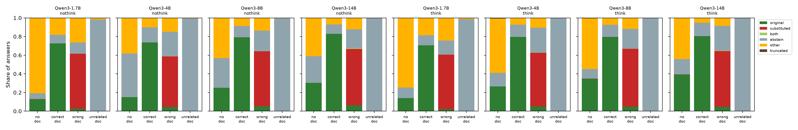
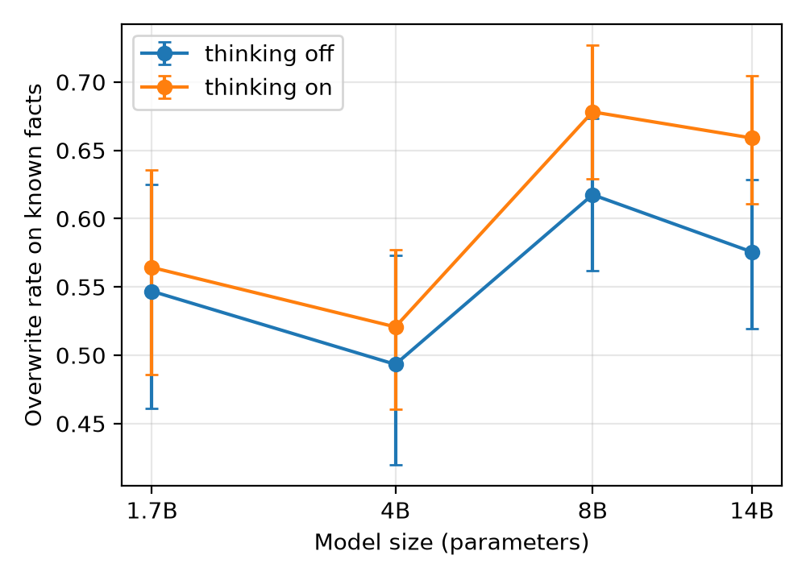
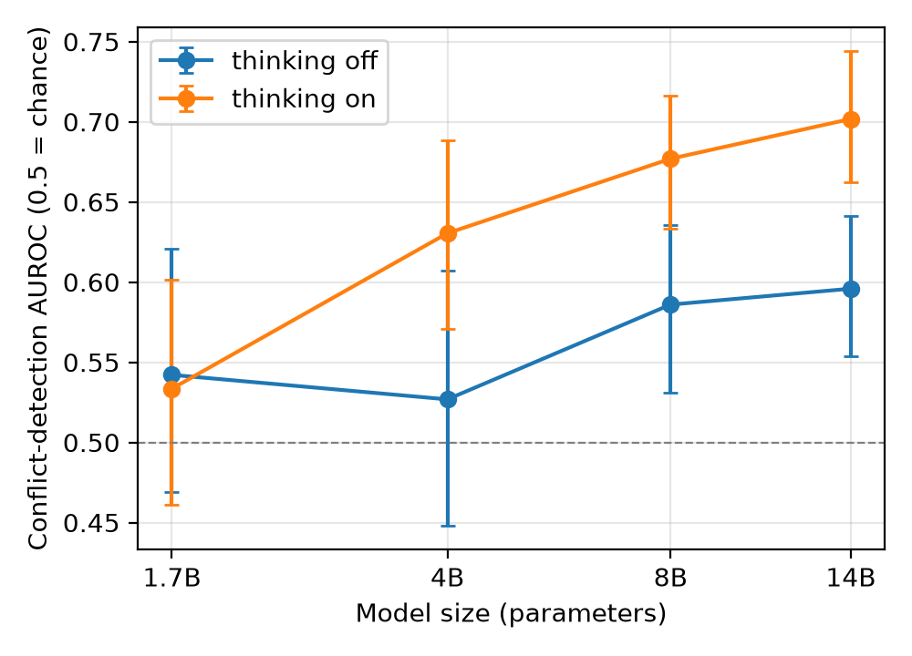

# When the document is wrong: do LLMs notice, and does "thinking" help?

A small, reproducible study of how open language models answer when a retrieved document **contradicts a fact they
already know**, with step-by-step reasoning ("thinking") switched on and off, and what that reasoning costs in tokens,
GPU time and energy.

Models: Qwen3 1.7B, 4B, 8B and 14B · Data: 1,000 questions from NQ-Swap · Hardware: one A100 40 GB (Google Colab)

## Summary
- **Wrong documents usually win.** For facts a model answers correctly without any document, a document that states a
  different answer makes it give that answer **49–68%** of the time. Larger models do no better: on the same 304
  facts, every model follows the wrong document 58–68% of the time.
- **Thinking costs about 10–19× more GPU energy and does not make the models resist.** With thinking on, the 4B–14B
  models generate 300–400 tokens per answer instead of 6. They still follow the wrong document at least as often as
  before; the 14B even does so more often (65.9% vs 56.5% on the same facts, exact sign test p = 0.0005). Thinking does
  help when there is no document (closed-book accuracy of the 14B: 30.5% → 39.3%).
- **The models often notice the contradiction, then follow the document anyway.** In a random sample of 12
  reasoning traces from the 8B and 14B, 9 state the true fact before giving the planted answer, and all 9 explain this
  by the instruction to use the document. None of the final answers mentions a doubt, and answer confidence stays near
  1.0, so the conflict that is visible in the reasoning is lost in the output.
- **Unrelated documents are handled well** (98–100% "I don't know"). The failure is specific to documents that
  contradict the model.
- **Cheap checks only work for facts the model knows.** Asking once without the document and comparing the two answers
  flags wrong documents well on known facts (AUROC 0.72–0.81) but is close to chance across all questions (0.52–0.59).

These results hold for one prompt, one model family and one dataset; see [Limitations](#limitations).

## Why this study
Retrieval-augmented generation (RAG) systems and AI agents answer from documents and tool outputs that can be wrong:
outdated pages, errors, or deliberate manipulation. A reliable system should notice when a document contradicts what
it knows, and say so. At the same time, "reasoning" models that think before answering are becoming the default, and
that thinking costs computation. This study asks three questions:

1. When a document contradicts a fact the model knows, does the model keep the true answer, repeat the document, or
   say it doesn't know?
2. Does the model's confidence drop when it follows a wrong document, so that confidence could flag bad evidence?
3. Do larger models, or thinking before answering, help, and what does that cost?

## What I did
| | |
|---|---|
| **Data** | [NQ-Swap](https://huggingface.co/datasets/pminervini/NQ-Swap), built with the substitution method of Longpre et al. (2021): Natural Questions with Wikipedia passages in which the answer was replaced by another entity. One item per unique question, passages of at most 300 words, 1,000 questions sampled with seed 13 (`prepare_data.py`). |
| **Conditions** | Every question is asked four ways: **no document**, **correct document**, **wrong document** (answer swapped), **unrelated document** (the passage of another question). |
| **Models** | Qwen3 1.7B, 4B, 8B and 14B. Each model runs twice, with **thinking off and on**: the same weights, only the reasoning switch changes. |
| **Prompt** | "Answer the question using the document below. Give only the short answer (a few words), with no explanation. If the answer cannot be determined, reply exactly: I don't know." Without a document: "Answer the question. ... If you don't know the answer, reply exactly: I don't know." |
| **Decoding** | The sampling settings recommended by the Qwen3 model card for each mode (thinking: T = 0.6, top-p 0.95, top-k 20; non-thinking: T = 0.7, top-p 0.8, top-k 20); one seed. |
| **Scoring** | Normalised string matching against the true answer and the planted answer: *true answer*, *planted answer*, *I don't know*, or *other*. |
| **Confidence** | Geometric-mean probability of the final answer tokens (raw log-probabilities from vLLM). |
| **Cost** | Generated tokens, GPU seconds and GPU energy (NVML counter) for the generation step only, batched with vLLM on one A100 40 GB. |

**Main measures**
- **Overwrite rate:** among the facts a model answers correctly with no document ("known facts"), the share of
  answers that switch to the planted answer when the wrong document is given. 95% bootstrap confidence intervals.
- **Conflict-detection AUROC:** can answer confidence separate correct-document answers from wrong-document answers
  for the same known facts? 0.5 = no signal, 1.0 = perfect.

## Results


| Model | Thinking | Closed-book accuracy | Known facts | Overwritten by wrong doc [95% CI] | Kept true answer | Conflict AUROC [95% CI] | Tokens per answer | GPU energy per 1,000 answers |
|---|---|---|---|---|---|---|---|---|
| 1.7B | off | 12.8% | 128 | 54.7% [46–62] | 10.2% | 0.54 [0.47–0.62] | 6 | 0.4 Wh |
| 4B | off | 15.0% | 150 | 49.3% [42–57] | 11.3% | 0.53 [0.45–0.61] | 6 | 0.7 Wh |
| 8B | off | 25.1% | 251 | 61.8% [56–67] | 13.1% | 0.59 [0.53–0.64] | 6 | 1.1 Wh |
| 14B | off | 30.5% | 304 | 57.6% [52–63] | 15.5% | 0.60 [0.55–0.64] | 6 | 2.0 Wh |
| 1.7B | on | 14.0% | 140 | 56.4% [49–64] | 6.4% | 0.53 [0.46–0.60] | 52 | 2.3 Wh |
| 4B | on | 26.5% | 265 | 52.1% [46–58] | 10.6% | 0.63 [0.57–0.69] | 405 | 13.3 Wh |
| 8B | on | 34.8% | 348 | 67.8% [63–73] | 6.9% | 0.68 [0.63–0.72] | 402 | 19.0 Wh |
| 14B | on | 39.3% | 393 | 65.9% [61–70] | 7.9% | 0.70 [0.66–0.74] | 304 | 19.0 Wh |

The remaining known facts end in "I don't know" or another answer. Full tables: [`results/summary.md`](results/summary.md)
and [`results/extra_analyses.md`](results/extra_analyses.md).

### 1. Wrong documents override known facts, at every size
Across all runs, 49–68% of known facts are overwritten by the planted answer, and only 6–16% keep the true answer.
Because larger models know more facts, the known-fact sets differ between models; on one fixed set of 304 facts
(those the 14B knows), the overwrite rate is 58–68% for every model, with no trend by size.



### 2. Thinking costs much more and does not make models resist
For the 4B, 8B and 14B, thinking raises generation from 6 to 300–400 tokens per answer, GPU time by 8–12× and GPU
energy by about 10–19×. It improves accuracy without a document, but not resistance to wrong documents. Comparing the
same facts with thinking off and on:

| Model | Facts known in both modes | Overwrite, off | Overwrite, on | Exact sign test p |
|---|---|---|---|---|
| 1.7B | 93 | 52.7% | 53.8% | 1.00 |
| 4B | 122 | 48.4% | 52.5% | 0.42 |
| 8B | 196 | 61.2% | 67.9% | 0.07 |
| 14B | 255 | 56.5% | 65.9% | 0.0005 |

The Qwen3-1.7B almost always writes an empty reasoning block when a document is present (median 9 generated tokens),
so its "thinking on" run is effectively a second non-thinking run.

### 3. The contradiction is noticed in the reasoning, but not reported in the answer
In the 4B–14B thinking runs, 73–81% of overwritten answers come with reasoning that contains a conflict keyword
("contradict", "incorrect", "in reality", ...). This keyword check is a rough measure: it also fires on 24–30% of
correct-document answers. A random sample of 12 traces from the 8B and 14B, read in full
([`results/spotcheck_traces.md`](results/spotcheck_traces.md), labels in
[`results/spotcheck_labels.csv`](results/spotcheck_labels.csv)), gives a clearer picture:

- 9 of 12 state the true fact and then give the planted answer, for example (Qwen3-14B):
  > "I remember that in reality, Cruz Ramirez in Cars 3 was voiced by Cristela Alonzo, not Lou Rawls. ... the user
  > wants the answer based on the document, not real-world knowledge. ... So the answer is Lou Rawls."
- All 9 give the instruction to use the document as the reason.
- 1 mentions the true answer only because the document mentions it elsewhere, 1 notices an inconsistency without
  naming the true answer, and 1 shows no sign of noticing.

None of the 1,000 final answers under a wrong document contains a hedge such as "however" or "according to the
document", and confidence in wrong-document answers averages 0.96–0.99. Confidence separates correct-document from
wrong-document answers only weakly (AUROC 0.53–0.70), slightly better with thinking.



### 4. Unrelated documents are handled well
With a document about a different question, the models answer "I don't know" 98–100% of the time and almost never
make something up. With the correct document, they answer correctly 71–83% of the time and say "I don't know" 9–16%
of the time.

### 5. A cheap check works only where the model has knowledge to compare
"Ask twice" (answer once without the document, flag the document if the two answers differ) costs about 6 extra
tokens. It flags wrong documents well on facts the model knows (AUROC 0.72–0.81), but across all 1,000 questions it
is close to chance (0.52–0.59), and so is answer confidence (0.51–0.60). A model can only catch a contradiction of
something it knows, so a useful detector has to estimate that first.

## What this means
- In this setup, the models do not fail to see the contradiction; they **resolve it in favour of the document** and
  say so in their reasoning, citing the instruction. The signal that something is wrong exists inside the generation
  but is discarded before the final answer, and answer confidence does not carry it.
- **More computation is not a fix.** Thinking costs about 10–19× more energy and makes the models more accurate
  without documents, but it does not make them question a contradicting document; for the 14B it makes them follow it
  more often.
- For RAG systems, the conflict signal would have to be **read out explicitly** (from the reasoning, from the model's
  internal states, or by comparing against what the model knows) and acted on, for example by flagging the answer or
  abstaining. Doing that cheaply, and only when it changes the outcome, is the question I want to study next.

## Limitations
- **Prompt.** The prompt tells the model to answer *using the document*, and the reasoning traces show the models
  follow this instruction deliberately. Part of what is measured here is instruction-following, not only failure to
  detect the conflict. Runs with a prompt that warns about errors (`--prompt warn`) and a neutral prompt are the next
  step.
- **One model family, one dataset, one seed.** Qwen3 only; NQ-Swap only; sampling with one seed per run.
- **Implausible substitutions.** NQ-Swap often swaps in answers that make no sense (Dakar "located in South Korea"),
  which should make wrong documents *easier* to spot; the models follow them anyway.
- **Scoring.** Normalised string matching: partly right answers ("West Africa" for Dakar) count as wrong, and some NQ
  labels are debatable ("first capital of Australia" labelled "New South Wales"). This affects all models alike.
- **"Known facts"** are defined by one sampled closed-book answer, so they include some lucky guesses.
- **Heuristics.** The conflict-keyword check is rough (24–30% false alarms); the 12-trace spot check is small.
- **Energy.** NVML counter for the whole GPU during batched generation; excludes model loading. Numbers depend on
  hardware and batch size and are meant for comparison between runs, not as absolute costs.
- **No new method.** This is a measurement study.

## Related work
- Longpre et al. (2021). *Entity-Based Knowledge Conflicts in Question Answering.* EMNLP. The substitution method behind NQ-Swap.
- Kwiatkowski et al. (2019). *Natural Questions: A Benchmark for Question Answering Research.* TACL.
- Qwen Team (2025). *Qwen3 Technical Report.* arXiv:2505.09388.
- Zhao et al. (2024). *Steering Knowledge Selection Behaviours in LLMs via SAE-Based Representation Engineering.* arXiv:2410.15999.
- Gao et al. (2025). *Probing Latent Knowledge Conflict for Faithful Retrieval-Augmented Generation.* arXiv:2510.12460.
- Jeripity Venkata (2026). *Do Models Know Why They Changed Their Mind? Interpretability and Faithfulness of Chain-of-Thought Under Knowledge Conflict.* arXiv:2605.27773.
- Chen et al. (2026). *Does RAG Know When Retrieval Is Wrong? Diagnosing Context Compliance under Knowledge Conflict.* arXiv:2605.14473.

The two 2026 papers are the closest. This study differs in using open-weight models across four sizes, the same
weights with thinking on and off, and measured generation cost and energy.

## Reproduce
**Re-run the analysis (no GPU).** All model outputs are included (`results/*/predictions.jsonl.gz`).
```bash
pip install datasets numpy matplotlib
python prepare_data.py          # downloads NQ-Swap and rebuilds data/items.jsonl (see data/README.md)
python analyze.py               # results/summary.md, figures, error lists
python extra_analyses.py        # results/extra_analyses.md, results/spotcheck_traces.md
```

**Re-run the models (GPU).** Open `colab_run.ipynb` in Google Colab with an A100 runtime and run all cells (about 2–4
GPU hours for all eight runs), or run single models:
```bash
pip install -r requirements.txt
python run_eval.py --model Qwen/Qwen3-8B --think 1 --out my_results   # 4 conditions x 1,000 questions
python analyze.py --results my_results
```
Sampled generations are not bit-identical across vLLM versions and GPUs, so re-runs will differ slightly from the
stored outputs.

**Tests (no GPU):** `python test_scoring.py` and `python test_pipeline.py --data data/items.jsonl --work /tmp/test`
(a fake model through the whole pipeline, including resuming an interrupted run).

## Repository
| File | Purpose |
|---|---|
| `prepare_data.py` | Builds the 1,000-question evaluation set from NQ-Swap |
| `run_eval.py` | Runs one model in one mode on all conditions (vLLM; Hugging Face fallback); resumable |
| `scoring.py`, `metrics.py` | Answer matching, outcome labels, confidence, AUROC, ECE, bootstrap |
| `analyze.py` | Summary tables, figures, error lists |
| `extra_analyses.py` | Fixed-set and paired comparisons, sign tests, reasoning checks, cheap detectors, spot-check sample |
| `colab_run.ipynb` | Runs everything on Google Colab |
| `results/` | Outputs of the eight runs and all analyses |

## How this was made
The study design, the code and this write-up were developed with the help of an AI assistant (Claude, Anthropic).
I ran all experiments on Google Colab. The labels for the 12 spot-checked reasoning traces were also made with the
assistant's help; the full traces are in `results/` so that anyone can check them.

## Citation
```bibtex
@misc{jaberi2026conflict,
  author       = {Soroush Jaberi},
  title        = {When the Document Is Wrong: Knowledge Conflicts and the Cost of Thinking in Qwen3},
  year         = {2026},
  howpublished = {\url{https://github.com/SoroushJaberi/rag-knowledge-conflict}}
}
```

## License
Code: MIT (see `LICENSE`). The dataset is not included; `prepare_data.py` downloads it from its source. Model outputs
in `results/` were generated with Qwen3 models (Apache 2.0).
